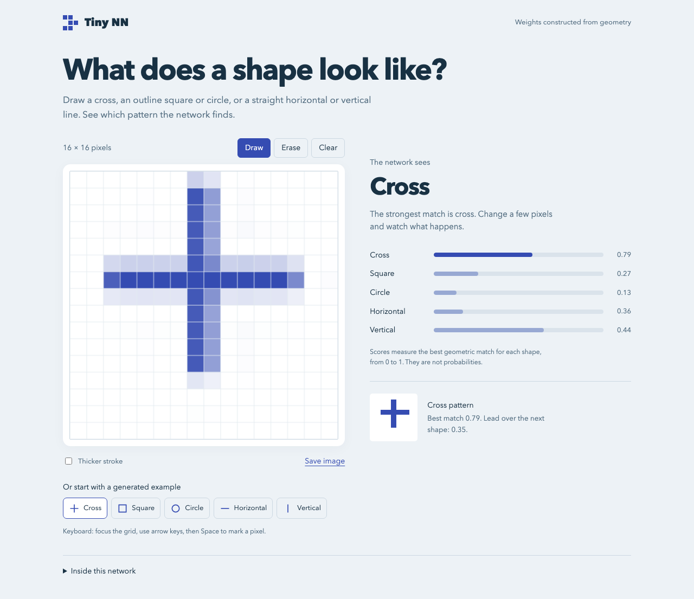
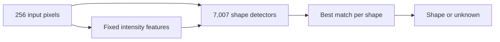

# Tiny NN

### 9,056 hidden units. Zero training.

[](https://github.com/ottobonilla95/tiny-nn/actions/workflows/tests.yml)
[](pyproject.toml)
[](LICENSE)

A visual neural network with **every weight constructed from geometry**. Draw a shape, inspect the closest pattern, and see why the network recognizes it or returns “unknown.”

No training loop, pretrained weights, or GPU. Just Python, NumPy, Pillow, and a small drawing lab.



## What can it recognize?

**Crosses · square outlines · circle outlines · horizontal lines · vertical lines**

Each input is a 16×16 grayscale image. The network compares it with thousands of geometric patterns, then rejects weak or ambiguous matches.

| Inside the model | Count |
| --- | ---: |
| Input pixels | 256 |
| Hidden units | 9,056 |
| Fixed connection weights | 1,804,895 |
| Training steps | **0** |

The weights follow repeated mathematical rules; they are not 1.8 million independently chosen numbers. This is geometric template matching expressed as a neural network.

## Run the drawing lab

Install [uv](https://docs.astral.sh/uv/getting-started/installation/), then:

```sh
git clone https://github.com/ottobonilla95/tiny-nn.git
cd tiny-nn
uv sync
uv run tiny-nn build
uv run tiny-nn demo --open
```

The lab opens at **http://127.0.0.1:8765**. Draw a shape, try an example, erase pixels, and watch the scores change. The panel beside the grid shows the closest geometric pattern. You can also save your drawing as a PNG.

`uv` manages the Python 3.12 environment and installs the locked dependencies. Everything runs locally on the CPU. Stop the server with **Ctrl-C**; use `--port 8766` if port 8765 is busy.

### Test your own image

```sh
# A light shape on a dark background, including PNGs saved from the lab.
uv run tiny-nn predict drawing.png

# Dark ink on a light background.
uv run tiny-nn predict drawing.png --invert
```

Images are resized and padded to 16×16. Keep one simple shape in the frame. The returned match scores measure similarity, **not probability**.

## Does it work?

The fixed model scored **93.8% on 1,500 fresh synthetic test images**, after the design was developed using a separate set of 500 images.

| Test | Result |
| --- | ---: |
| Overall, including unknown examples | **93.8%** |
| Known shapes | **94.8%** |
| Clean shapes | **97.3%** |
| Unknown examples correctly rejected | **89.7%** |

The test images use an independent drawing implementation, with varying positions, sizes, stroke widths, noise, and gaps. Exact development images are excluded from the test set.

The main weakness: some filled blobs look like thick crosses at this resolution. Heavy noise also hurts. These results describe synthetic shapes; freehand drawings are a further experiment.

**[See the full evaluation, including mistakes](docs/evaluation.md)** · [Read the recorded metrics](results/baseline/metrics.json)

## How can a neural network work without training?

A neural network computes with weights. For a narrow task whose rules we know, we can derive those weights directly.

Tiny NN builds patterns for each shape at different positions, sizes, and stroke widths. Fixed ReLU features handle soft pixel edges, template detectors measure the match, and max pooling picks the strongest result in each shape family. A fixed threshold decides when to answer “unknown.”



No weights are fitted to examples. Development images helped improve the design; the final test was evaluated after the weights were fixed.

**[Explore the architecture and weight formulas](docs/architecture.md)**

## Explore the code

| File | What it does |
| --- | --- |
| [`network.py`](tiny_nn/network.py) | Constructs the weights and runs the network |
| [`dataset.py`](tiny_nn/dataset.py) | Draws independently labeled test images |
| [`evaluate.py`](tiny_nn/evaluate.py) | Measures accuracy and generates reports |
| [`web.py`](tiny_nn/web.py) + [`lab.html`](tiny_nn/lab.html) | Connect the drawing lab to the Python model |

Run the 12 automated checks:

```sh
uv run python -m unittest discover -s tests -v
```

Want to experiment? Add a shape family, change the geometric coverage, or investigate a failure. The [contribution guide](CONTRIBUTING.md) explains how to keep development and test results separate.

## License

[MIT](LICENSE) © 2026 Otto Joseph.
