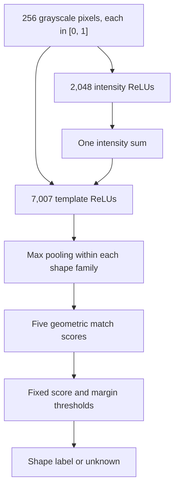

# How Tiny NN constructs its weights

[Back to the project](../README.md) · [Evaluation](evaluation.md)

Tiny NN implements geometric template matching as a feedforward network. Its weights are calculated from shape definitions and fixed formulas. There is no optimizer, gradient descent, or pretrained checkpoint.

## The computation

The network has 256 inputs, 2,048 intensity ReLUs, one intensity sum, 7,007 template ReLUs, and five class-pooling outputs. Original pixels also connect directly to the template layer.



## 1. Approximate pixel intensity squared

For each pixel `x`, construct eight features:

```text
u_j(x) = ReLU(x − j/8), for j = 0, …, 7

q(x) = (1/8)u_0(x) + (2/8)[u_1(x) + … + u_7(x)]
```

This is a piecewise linear approximation to `x²` on `[0, 1]`. Its maximum error per pixel is `1/256`. The slopes and breakpoints are calculated directly; no examples determine them.

Sum those outputs across the image:

```text
E(x) = sum_i q(x_i)
```

That energy estimate lets the next layer compare soft, antialiased edges more effectively than exact binary-pixel matching.

## 2. Construct geometric templates

The compiler creates templates at every integer position that fits inside the grid:

- Crosses, hollow squares, circular rings, horizontal lines, and vertical lines.
- Every integer size from 7 to 13 pixels.
- Strokes of 1–3 pixels for crosses and lines; 1–2 for squares and circles.
- Analytic subpixel sampling to estimate coverage around circular edges.

The template compiler lives in [`geometric_templates()`](../tiny_nn/network.py). It does not call the dataset's Pillow renderer.

## 3. Calculate each detector's weights

For a flattened template `t`, let `m = sum(t²)`. Construct one detector with:

```text
inputs  = [x_0, …, x_255, E(x)]
weights = [2t_0/m, …, 2t_255/m, −1/m]
bias    = 0

activation = ReLU((2t·x − E(x)) / m)
```

This approximates:

```text
ReLU(1 − sum((x − t)²) / sum(t²))
```

A close geometric match scores near 1. Large differences score near 0. The score is a similarity measurement, not a calibrated probability.

## 4. Pool and reject

Max pooling selects the strongest detector within each shape family. The model returns `unknown` when:

- The best score is below **0.55**, or
- The best score leads the next class by less than **0.08**.

These are fixed engineering thresholds. Rejection is useful when an image resembles none of the shapes, or resembles multiple shapes almost equally.

## Size and storage

| Component | Hidden units |
| --- | ---: |
| Intensity features | 2,048 |
| Intensity sum | 1 |
| Cross detectors | 1,113 |
| Square detectors | 742 |
| Circle detectors | 742 |
| Horizontal detectors | 2,205 |
| Vertical detectors | 2,205 |
| **Total** | **9,056** |

There are **1,804,895 logical connection weights** and **9,056 biases**. The connection count includes zero-valued detector weights and repeated connections in the shared intensity construction. Max pooling has no weights.

Only eight intensity slopes and eight knots need to be stored, because they repeat for every pixel. The detector matrix is also repetitive. The compressed model archive is about **67 KiB**, even though its expanded detector matrix has 1,800,799 entries.

The number of connections does not represent the number of independently chosen values or a measure of general intelligence. Coverage comes from deliberately repeated geometric patterns.

## Build, inspect, and save

```sh
uv run tiny-nn build
```

This creates:

- `artifacts/model.npz`: the detector weights, biases, intensity coefficients, class assignments, and fingerprint.
- `artifacts/model.json`: model dimensions, thresholds, counts, and fingerprint.

The archive loads without pickle, and loading verifies its fingerprint. Construction is deterministic. The drawing frontend sends pixels to this saved Python network; it contains no separate shape classifier.

The automated tests verify independent reference shapes, translations, missing pixels, negative examples, the intensity approximation bound, batch predictions, and save/reload integrity.
