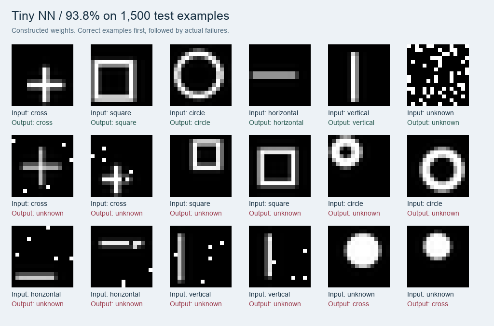

# What the first model gets right—and wrong

[Back to the project](../README.md) · [Architecture](architecture.md) · [Recorded metrics](../results/baseline/metrics.json)

The first fixed model scored **93.8% on 1,500 synthetic test images**. This page records the experiment, its limitations, and the commands to reproduce it.

## Results

| Measure | Result |
| --- | ---: |
| Overall accuracy, including unknowns | **93.8%** (1,407/1,500) |
| Known-shape accuracy | **94.8%** (1,138/1,200) |
| Unknown examples correctly rejected | **89.7%** (269/300) |
| Clean-shape accuracy | **97.3%** (292/300) |
| Thick-stroke accuracy | **95.0%** (285/300) |
| Noisy-shape accuracy, 2–5 flipped pixels | **90.3%** (271/300) |
| Gapped-shape accuracy, 1–3 removed foreground pixels | **96.7%** (290/300) |

### By shape

| Expected shape | Correct | Accuracy |
| --- | ---: | ---: |
| Cross | 238/240 | 99.2% |
| Square | 217/240 | 90.4% |
| Circle | 226/240 | 94.2% |
| Horizontal line | 229/240 | 95.4% |
| Vertical line | 228/240 | 95.0% |
| Unknown | 269/300 | 89.7% |

## Look at the mistakes

The top row below contains correct examples. The following rows show up to two failures per expected class, selected in dataset order.



All **62 errors on known shapes were rejections**, rather than assignments to another known shape. Of the **31 incorrectly accepted unknowns**, 29 were filled blobs classified as crosses and two were scribbles classified as horizontal lines.

Filled blobs are a real weakness: only 31 of the 60 blob examples were rejected. At this resolution, some blobs resemble thick crosses closely enough to pass the fixed acceptance rule.

### Noise stress test

The same 300 clean images were evaluated with increasing numbers of randomly selected pixels inverted:

| Flipped pixels out of 256 | Accuracy |
| --- | ---: |
| 0 | 97.3% |
| 3 | 93.7% |
| 8 | 54.0% |
| 13 | 30.7% |
| 26 | 4.3% |

These results show a limited tolerance for corruption. Sparse shapes are particularly vulnerable because a few extra pixels can be a large fraction of their foreground area.

## How the experiment was separated

The architecture was revised using **500 development images**, with a final development accuracy of 92.4%. The resulting weights and thresholds were then kept fixed for the **1,500-image test** recorded here.

No optimizer fitted weights to either dataset. Development examples informed changes to the mathematical design. The test results did not feed into another revision of this model.

The weight compiler uses analytic masks. The independent dataset generator uses Pillow vector primitives at 128×128, then downsamples to 16×16. It never imports the template generator. Labels come from the drawing commands, not predictions.

Known examples vary continuously in size, position, and stroke width. Each of the five shapes has four conditions: clean, thick, noise, and gaps. Unknowns include triangles, diagonal lines, scribbles, filled blobs, and random speckles. Blank and fully filled images are included in a generated split when their exact images have not already been excluded; both are also tested independently by unit tests.

- **Development seed:** `1729`, with 20 examples per shape and condition, plus 100 unknowns.
- **Test seed:** `8675309`, with 60 examples per shape and condition, plus 300 unknowns.
- Exact pixel hashes prevent duplicate images within a split.
- The test generator excludes all images from the development manifest.
- Known classes are equally represented. Unknown examples account for 20% of each split.

The [recorded metrics](../results/baseline/metrics.json) include the model fingerprint, both dataset identifiers, confusion matrix, per-condition results, noise sweep, and all 93 failures. Sample image paths in that file refer to the generated test dataset.

## Reproduce the evaluation

From a fresh clone, after `uv sync`:

```sh
uv run tiny-nn build
uv run tiny-nn dataset --split dev --per-case 20
uv run tiny-nn evaluate --data artifacts/data/dev --output artifacts/reports/dev

uv run tiny-nn dataset --split test --per-case 60 --exclude artifacts/data/dev
uv run tiny-nn evaluate --data artifacts/data/test --output artifacts/reports/test
```

Open `artifacts/reports/test/report.html` for the full visual report. The evaluation also writes `metrics.json`, `predictions.json`, and `examples.png`. The dataset directory contains the PNGs, generation parameters, labels, and pixel hashes.

Generated artifacts are ignored by Git. The small baseline metrics file and screenshots committed here preserve the original result without requiring readers to run the model.

Existing datasets and reports are preserved: commands refuse to replace them. For another run, choose new output paths and a new seed:

```sh
uv run tiny-nn dataset --split test --seed 2027 --output artifacts/data/test-2027 --exclude artifacts/data/dev
uv run tiny-nn evaluate --data artifacts/data/test-2027 --output artifacts/reports/test-2027
```

## What this establishes

This experiment covers isolated, mostly axis-aligned geometric shapes on a 16×16 grid. It does not establish accuracy on handwriting, photographs, overlapping shapes, arbitrary rotations, or every possible unknown image.

Translation and size tolerance come from explicitly constructed pattern coverage. The network does not learn new invariances. Different seeds and pixel hashes help separate examples, but a synthetic generator still defines a narrow world.

If results are used to change the model, those examples have become development data. A further claim about generalization needs a new untouched test set.
